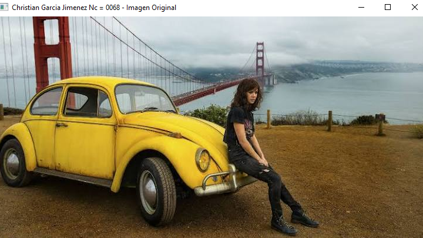
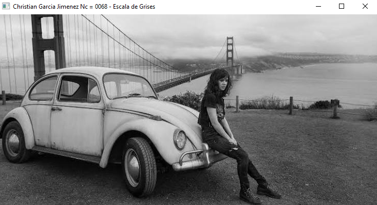
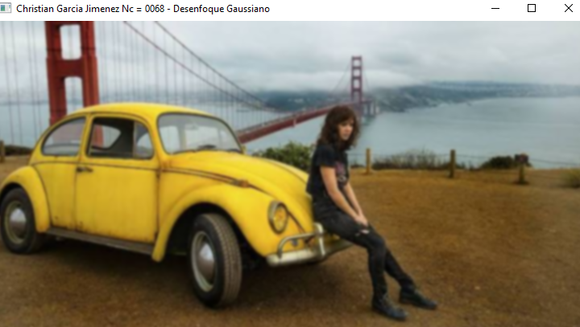
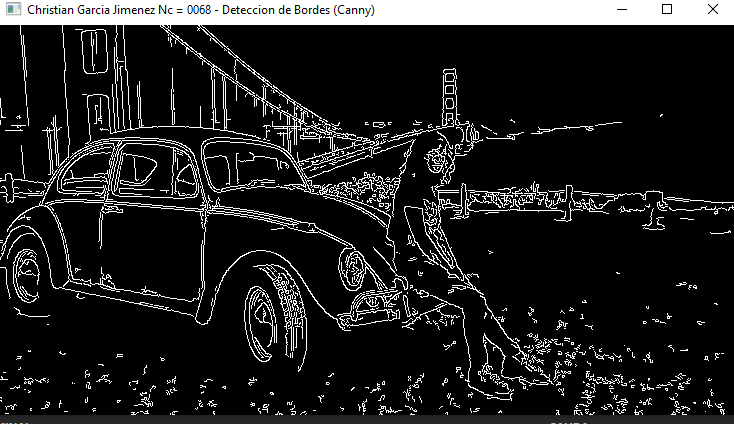
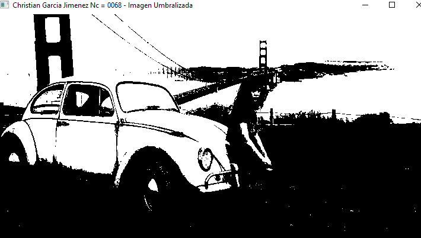
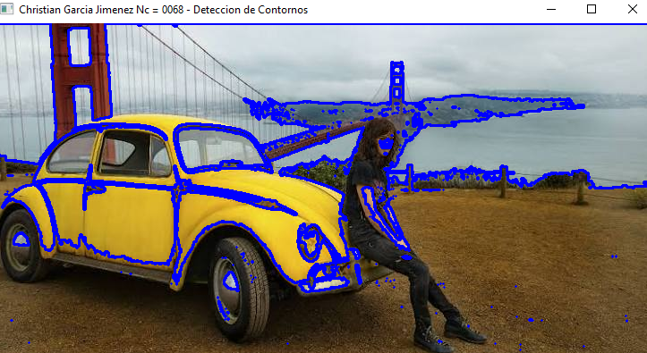
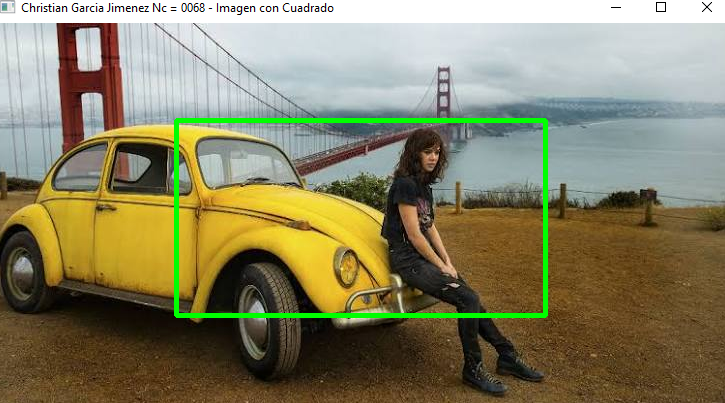

# Christian Garcia Jimenez 
# Nc = 0068
## imagen original 

## Imagen a escala a grises

## Imagen desenfocada

## deteccion de bordes

## Aplicar umbralización binaria

##  Detección de contornos

## Dibujar formas y añadir texto
